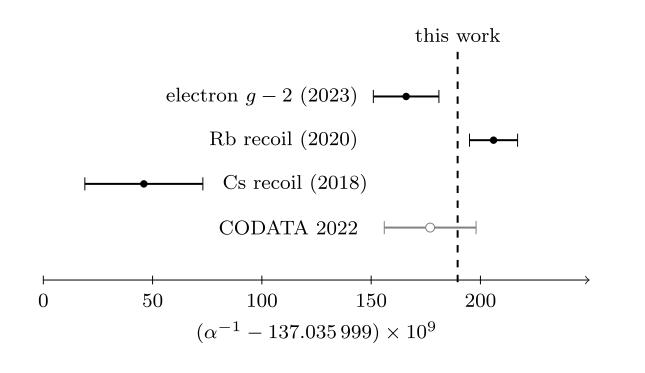

# A Parameter-Free Candidate for the Fine-Structure Constant from Entangled Qudits

A. D. Wissner-Gross · alexwg@alexwg.org · [www.alexwg.org](https://www.alexwg.org) · [ORCID 0000-0002-4818-7674](https://orcid.org/0000-0002-4818-7674)

**[Paper (PDF)](papers/alpha/alpha.pdf)** · **[Lean 4 check](papers/alpha/lean/)** · [Source and records](papers/alpha/)

## Abstract

We derive an exact candidate for the fine-structure constant α(0) from one parameter-free quantum-information axiom: nothing exists but finitely many maximally entangled pairs of finite-dimensional systems, some shared, known only by distilling them. Its one readable link with an acting central charge, a qutrit with a qubit, has the Standard Model gauge group (SU(3) × SU(2) × U(1))/ℤ₆ and two-point function (79 + 48√2 + 42√3 + 3√6)/31104 = 1/137.035 999 190…. We conjecture that this link is the elementary link of the photon, making the number α(0), 0.6σ from CODATA 2022. Lean 4 checks the computation.



*Figure 3. The inverse of the derived number, α⁻¹ = 137.035 999 189 6… (dashed), against the one-standard-deviation intervals of the most precise determinations of α(0): the electron magnetic moment with the Standard Model prediction (Fan et al. 2023), 137.035 999 166(15); rubidium recoil (Morel et al. 2020), 137.035 999 206(11); cesium recoil (Parker et al. 2018), 137.035 999 046(27); and the CODATA 2022 adjustment of such inputs (open circle; Mohr et al. 2025), 137.035 999 177(21). The exact form carries no uncertainty of its own; it lies +1.6σ, −1.5σ, +5.3σ and +0.6σ from these values.*

## Citation

```bibtex
@misc{WissnerGross2026alpha,
  author    = {Wissner-Gross, A. D.},
  title     = {A Parameter-Free Candidate for the Fine-Structure Constant from Entangled Qudits},
  year      = {2026},
  version   = {1.0.0},
  note      = {Preprint}
}
```

## Supplement: a compendium of preliminary findings

**Chain Theory: Toward Fundamental Physics from Distilling Networks of Entangled Qudits.** Release 0.1, a working draft. [PDF](compendium/pdf/compendium.pdf) · [README](compendium/README.md)

<details>
<summary>Abstract</summary>

Chain Theory is an emerging program to study fundamental physics through the lens of quantum information. In the spirit of Wheeler’s ‘it from bit,’ its single axiom says that nothing exists but finitely many maximally entangled pairs of finite-dimensional systems, some shared, known only by distilling them. This compendium collects some of the program’s preliminary findings to date, each stated in standard form beside its derivation and graded as a theorem, a conditional theorem, or an open result. From the axiom we obtain, as conditional theorems, the state space, the Born rule, unitarity, the uncertainty relation, the rotation and Lorentz groups, the signature of spacetime, and parity, time reversal, and CPT, and, as a theorem, conservation laws. We identify correspondences between (M,N) links of finite M- and N-dimensional systems with: spacetime for (2,2), electromagnetism for (3,2), the strong interaction for (3,3), the weak interaction for (4,2), the Yukawa sector for (4,3), and the Higgs for (4,4). We obtain the gauge group SU(3) × SU(2) × U(1) and the second law as theorems; as conditional theorems, an exact algebraic number conjectured to be the Thomson-limit fine-structure constant within 0.60 sigma of its measured value, the electron anomalous moment through third order, the hydrogen spectrum, parity violation, confinement, the running of the couplings, decay rates as finite sums with no renormalization, curvature, and the cosmological term; and, partly as conditional theorems and partly as open results, three generations, masses, and anatomies of the Standard Model particles. Beyond the Standard Model, the same construction yields, as theorems, band structure and the Chern number, phase transitions, and a distillation theorem for quantum computation. This release holds 100 theorems, 109 conditional theorems and 198 open results; 64 of the 100 theorems are tied to named Lean declarations, which check the finite computations their derivations use.

</details>

<details>
<summary>BibTeX</summary>

```bibtex
@misc{WissnerGross2026compendium,
  author    = {Wissner-Gross, A. D.},
  title     = {Chain Theory: Toward Fundamental Physics from Distilling Networks of Entangled Qudits},
  year      = {2026},
  version   = {0.1.0},
  note      = {A compendium of preliminary findings, release 0.1}
}
```

</details>

## Slides

[*Chain Theory: An Introduction*](talks/introduction.pdf) is a 71-slide overview of the axiom, the α(0) computation and its comparison with experiment, and the compendium (PDF).

## How to check it

The computation is checked by a single Lean 4 file with no dependencies, [`papers/alpha/lean/ChainAlpha.lean`](papers/alpha/lean/ChainAlpha.lean). Its [README](papers/alpha/lean/README.md) states what the file proves and maps each result of the paper to its declaration.

```
cd papers/alpha/lean
lake build          # Lean 4.35.0, pinned in lean-toolchain; about two minutes and 2 GB of memory
python3 audit.py    # the paper's audit rule
```

Without Lean, a script using only the Python standard library rebuilds the 172 records from the slots and prints the closed form and its inverse to 60 digits, in under a second:

```
python3 papers/alpha/anc/enumerate_records.py
```

For the compendium, start at its [overview](compendium/OVERVIEW.md). Its [index](compendium/index/) lists every boxed statement with its grade, premises and Lean declarations. Its Lean packages need far more memory than the Letter's file; its README gives the requirements and the build record.

Corrections and objections are welcome, by an issue on this repository or by email.

## License

Code: [Apache License 2.0](LICENSE). Text, including the paper, the compendium, and the slides: [CC BY 4.0](LICENSE-CC-BY-4.0).

## Contact

alexwg@alexwg.org
