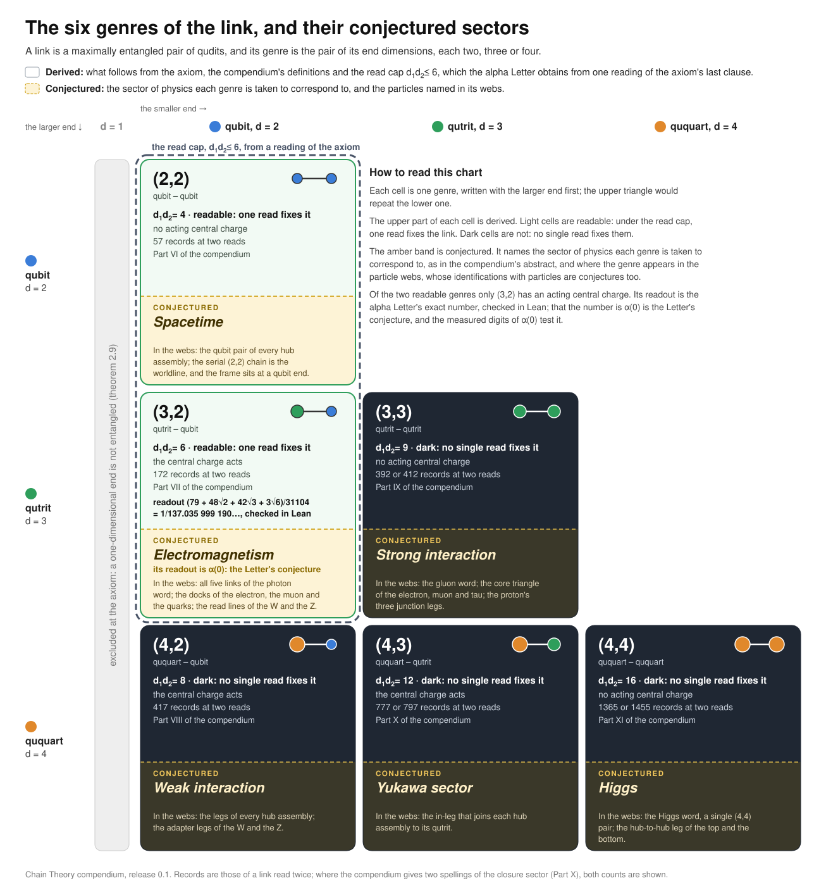
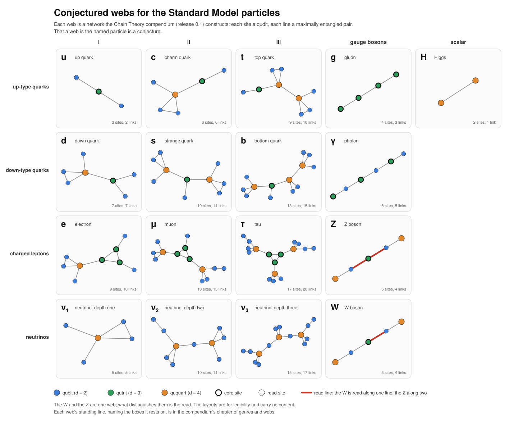

# Chain Theory compendium

**A compendium of preliminary findings, release 0.1. A working draft.** It collects the program's results beyond the alpha Letter. Each result is boxed in the text and graded by its author as a theorem, a conditional theorem or an open result.

The alpha Letter in [`papers/alpha`](../papers/alpha) is self-contained and depends on nothing here. Where the two state the same thing differently, the Letter is the canonical statement. In particular:
- the Letter has five definitions, the compendium six;
- the compendium's alpha chapter (Part VII, chapter 124) predates the Letter's read cap and its two exchanges, and its Lean check is the Letter's file.

## Central conjectures

Two conjectures organize the compendium. Each figure keeps what is derived apart from what is conjectured.

### The six genres of the link



- **Derived.** A link's two ends each have dimension two, three or four, so a link has one of six genres. Under the read cap d₁d₂ ≤ 6, exactly (2,2) and (3,2) are readable, and of these only (3,2) has an acting central charge. A one-dimensional end is excluded at the axiom (theorem 2.9). The readout of the (3,2) link is the alpha Letter's exact number, checked in Lean.
- **Conjectured.** Each genre corresponds to a sector of physics: (2,2) spacetime, (3,2) electromagnetism, (3,3) the strong interaction, (4,2) the weak interaction, (4,3) the Yukawa sector and (4,4) the Higgs.
- **What tests it.**
  - At (3,2), the measured α(0) tests it directly. The Letter's number lies 0.6σ from the CODATA 2022 value and between the two most precise determinations. It lies 5.3σ from cesium recoil, whose tension with rubidium is itself unresolved.
  - The other five genres are tested only through what their Parts of the compendium (VI to XI) derive and compare with measurement. In this release those Parts hold 17 theorems, 68 conditional theorems and 78 open results.

### Conjectured webs for the Standard Model particles



- **Derived.** Each web is a finite network of maximally entangled pairs that the compendium constructs, with each line a link of one of the six genres. Results about each web are graded there. By the weakest grade among the results each web rests on, of the 17 particles drawn (on 16 webs, since the W and the Z share one):
  - 1 rests on a theorem (the tau);
  - 11 rest on conditional theorems;
  - 5 rest on open results (the W, the Z, and the three neutrinos).
- **Conjectured.** Each web is the particle it is named for. The W and the Z are drawn as one web, read along one line and along two.
- **What tests it.** The numbers the compendium reads off the webs, such as masses and the ratio of the W and Z masses, compared with measured values. In this release those numbers are conditional theorems or open results. The [chapter of genres and webs](pdf/particle-webs.pdf) gives each web's standing and the boxes it rests on.

## What is here

| Path | What it is |
|---|---|
| [`OVERVIEW.md`](OVERVIEW.md) | **Start here.** For each Part, the opening paragraph of its introduction and its theorems and conditional theorems by title. A draft, assembled from the compendium |
| [`index/`](index/) | One page per Part listing every boxed statement with its number, grade, standing line, and Lean declarations, generated from the source. `statements.tsv` holds the same rows with each statement's premises and users, and `designators.tsv` maps every chapter number the text uses to its sections under both numberings. |
| [`pdf/compendium.pdf`](pdf/compendium.pdf) | The whole compendium, 754 pages |
| [`pdf/`](pdf/) | One PDF per Part and one for the instruments, cut from the whole |
| [`figures/`](figures/) | `genres.json`, the six genres of the link as data, and the [genre matrix](figures/genre-matrix.svg) drawn from it by `tools/genre_matrix.py` (also as a PNG for sharing, and as the bare PDF the chapter uses); `particles.json`, the webs the compendium records for the Standard Model particles as data (sites, links, roles, and each particle's standing and the weakest grade it rests on), and the chart and per-particle drawings made from it by `tools/particle_chart.py`. In both figures what is derived is kept apart from what is conjectured. The chapter that holds both, *The six genres and the conjectured webs of the Standard Model particles*, is also cut as [`pdf/particle-webs.pdf`](pdf/particle-webs.pdf) |
| [`tex/`](tex/) | The LaTeX source: one file per Part, the front and back matter, the instruments, and the chapter-number table. `./build.sh` builds the whole compendium and cuts the Part PDFs (TeX Live and qpdf) |
| [`lean/`](lean/) | Six Lean 4 packages: `ChainTheory` and the five it requires |
| [`tools/`](tools/) | `index.py` and `overview.py` regenerate `index/` (including the counts the abstract prints) and `OVERVIEW.md` from the source; `genre_matrix.py` and `particle_chart.py` draw the figures and write the chapter that holds them |

## How it is organized

The compendium follows the theory's own seams. Each cell is a genre of link, the pair of dimensions of its two ends, and Parts VI to XI take the six genres one at a time; the [genre matrix](figures/genre-matrix.svg) draws them, with the sector each is conjectured to correspond to.

| | Parts | Index |
|---|---|---|
| Foundations | I The framework · II The rule · III Quantum mechanics · IV Spacetime and symmetry · V The gauge structure | [I](index/01-framework.md) · [II](index/02-rule.md) · [III](index/03-quantum-mechanics.md) · [IV](index/04-spacetime-and-symmetry.md) · [V](index/05-gauge-structure.md) |
| The six cells | VI (2,2) metric, worldline and horizon · VII (3,2) the photon · VIII (4,2) the carriers and the breaking · IX (3,3) the junction · X (4,3) the Yukawa leg · XI (4,4) the Higgs | [VI](index/06-cell-2-2-metric-and-horizon.md) · [VII](index/07-cell-3-2-photon.md) · [VIII](index/08-cell-4-2-weak.md) · [IX](index/09-cell-3-3-strong.md) · [X](index/10-cell-4-3-yukawa.md) · [XI](index/11-cell-4-4-higgs.md) |
| Applications | XII Decays and nuclear physics · XIII Thermodynamics · XIV Condensed matter and atoms · XV Quantum information | [XII](index/12-decays-and-nuclei.md) · [XIII](index/13-thermodynamics.md) · [XIV](index/14-condensed-matter-and-atoms.md) · [XV](index/15-quantum-information.md) |
| Scorecard | XVI The results table, the open results and what remains | [XVI](index/16-scorecard.md) |
| Appendices | the conditions, the glossary, the moves, the saturation, the chapter numbers | [appendices](index/back.md) |
| Instruments | the 52 instrument chapters the Parts list, numbered I.1 to I.52 | [instruments](index/instruments.md) |

The glossary appendix gives each term of the construction (*sink*, *hub*, *dock*, *web*, and the rest) with the nearest standard notion. Most chapters also carry a paragraph headed *In the language of the literature*.

## The count, as of this release

These numbers are generated from the source by `tools/index.py`.

| Boxed statements | |
|---|---|
| Theorems | 100 |
| Conditional theorems | 109 |
| Open results | 198 |
| Tables | 56 |
| Definitions | 7 |
| **Numbered chapters** | **318** |

The 318 chapters are the 265 of the Parts and appendices, the chapter-number appendix and the 52 instruments. Of them, 113 name Lean declarations, and every named declaration is found: in the packages under `lean/`, or for the alpha chapter in the Letter's file.

The scorecard in Part XVI counts differently: it also counts superseded and re-posed results, so its totals are larger than the boxes counted here.

## What the Lean checks

The six packages are core Lean 4.32.1, with no Mathlib and no imports from outside. Each package requires the next by a relative path:

> AxiomDeclaration → ActClosure → AxiomDeclarationTwo → ActClosureCapFree and KernelDerivationC → ChainTheory

```
cd compendium/lean/ChainTheory
lake build
```

**Memory.** Nine modules, most of them in `AlphaDerivation`, need between 4 and 6 GB each. Build with 16 GB of memory, or with swap.

**Build record.** The packages were built with Lean 4.32.1, one module at a time and the large ones alone:
- all 493 modules that `lake build` in `ChainTheory` compiles, with no errors and no `sorry`;
- 66 minutes of compilation in all, and 5.9 GB at the most for one module. Each module's time and peak memory are in [`lean/build_record.tsv`](lean/build_record.tsv);
- the axiom report of `AxiomsCheck.lean`, committed as [`lean/ChainTheory/axioms_report.txt`](lean/ChainTheory/axioms_report.txt). It covers 6,662 declarations: 6,047 depend on no axiom, 605 on `propext` alone, and 10 on `propext` and `Quot.sound`. None uses `Classical.choice` or `sorryAx`, and the packages declare no axiom of their own.

`ActClosureCapFree`, which `ChainTheory` requires but does not import, is built on its own. Its 405 modules include 130 that need 3.5 to 5 GB each; its build record will be added when that build finishes.

**What the packages contain**, counted from the source:

| Kind | Count |
|---|---|
| Theorem declarations | 3,048 |
| Theorems that restate a data module's checks at their own type | 351 |
| Open results stated as opaque propositions | 770 |
| Data modules | 428 |
| Kernel modules | 3 |

**What a theorem here means.** Most theorem declarations are finite checks, decided by the kernel, over tables that enter the packages as data. These tables are checked for internal consistency, and only the three kernel modules derive theirs inside Lean. A chapter's named theorem therefore usually certifies the arithmetic of that chapter's tables. The physical reading of the result lives in the text, not in the Lean statement. Open results are opaque propositions, and conditional theorems carry their conditions as named hypotheses.

**What was removed.** Comments and doc comments were stripped from the source (`tools/strip_lean.py` documents the stripping), descriptive text inside some string literals was reworded, and three bookkeeping modules that recorded the history of the index rather than any result were removed. No proof of a remaining declaration was changed.

## Citing

```bibtex
@misc{WissnerGross2026compendium,
  author    = {Wissner-Gross, A. D.},
  title     = {Chain Theory: Toward Fundamental Physics from Distilling Networks of Entangled Qudits},
  year      = {2026},
  version   = {0.1.0},
  note      = {A compendium of preliminary findings, release 0.1}
}
```

[`CITATION.bib`](../CITATION.bib) holds the entries for both the compendium and the alpha Letter.
