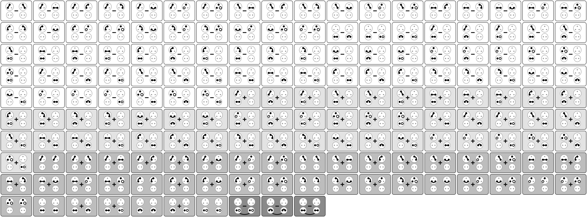

# A Parameter-Free Candidate for the Fine-Structure Constant from Entangled Qudits

> We derive an exact candidate for the fine-structure constant α(0) from one parameter-free quantum-information axiom: nothing exists but finitely many maximally entangled pairs of finite-dimensional systems, some shared, known only by distilling them. Its one readable link with an acting central charge, a qutrit with a qubit, has the Standard Model gauge group (SU(3) × SU(2) × U(1))/ℤ₆ and two-point function (79 + 48√2 + 42√3 + 3√6)/31104 = 1/137.035 999 190…. We conjecture that this link is the elementary link of the photon, making the number α(0), 0.6σ from CODATA 2022. Lean 4 checks the computation.

*Figure 2. The 172 measurement records of the object, one drawing each, on the square of slots of Figure 1(b): the shared qutrit's copies at the two read links above, with three dots each, and the two read qubits below, with two. Each cell's shade darkens with its record's weight: 79 records at 1 (white), 48 at √2 (light gray), 42 at √3 (mid gray), and 3 at √6 (dark gray). The three cells with an arc under the qubits are the commutator records, each the commutator of two qubit letters at the first read's qubit minus the same at the second's. The drawings depend on the choice of basis; the counts and weights do not. Drawn by `anc/draw_records.py` from the construction of `anc/enumerate_records.py`.*

## Files

| Path | What it is |
|---|---|
| `alpha.pdf` | the Letter (7 pages) with the Supplemental Material (17 pages) |
| `alpha.tex`, `supplement.tex`, `figures/` | REVTeX 4.2 source. The bibliography is inline. Build with `pdflatex alpha.tex`, run three times. `figures/records_figure.sh` builds Figure 2, `records_atlas.svg` and `records_atlas.pdf`, from `anc/draw_records.py` (the PDF step needs `cairosvg`). `figures/readme_figure.sh` builds `figures/comparison.svg`, the copy of Figure 3 shown in the repository README, from the same `fig_comparison.tex` |
| `anc/records.csv` | the 172 measurement records, with their exchange signs and weights |
| `anc/enumerate_records.py` | rebuilds the records from the slots and prints the closed form to 60 digits (Python standard library only) |
| `anc/draw_records.py` | draws Figure 2 from the records `enumerate_records.py` builds (Python standard library only) |
| `lean/` | the single-file Lean 4 check `ChainAlpha.lean`, as a Lake package with no dependencies, plus its README, audit script, perturbation script, and axiom report |

The source here is the comment-stripped arXiv source, with the figures in `figures/`. On arXiv, the files in `anc/`, `lean/ChainAlpha.lean` and `lean/mutations.py` are the ancillary files; a journal would carry them with the Supplemental Material.

## What the computation rests on

Table S1 of the Supplemental Material lists every input beyond the axiom:
- the five definitions, whose requirement that a fix leave nothing open gives the read cap;
- the two definitions of the computed quantity;
- three clauses of the definitions, which decide the weights.

Identifying the number with α(0) is a conjecture, the Photon Conjecture, which the coming measurements of α(0) will test. The Lean file checks the computation of the number itself.
